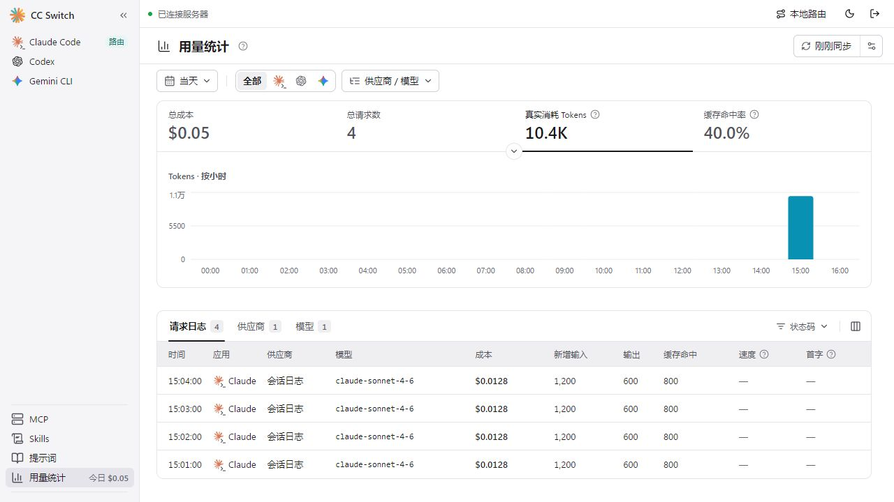

# Web 管理平台（独立入口）

这是给无桌面环境服务器使用的独立管理入口。浏览器页面与 Rust HTTP 服务独立启动，复用原工程的业务服务、数据库、客户端配置投影、冲突检测及模式恢复方法。原桌面入口和方法签名保留；少量共享命令提取了不依赖窗口的内部方法，桌面端仍走原来的调用流程。

当前复用原侧栏、主题、供应商表单、MCP、提示词、Skills、Profile、应用管理和统计界面，并提供适合 Web 的设置页，管理 Claude Code、Codex、Gemini CLI。令牌只保留在当前页面内存中，刷新页面需要重新连接。多个浏览器通过带鉴权的 SSE 接收变更通知并重新读取状态；供应商编辑与删除携带数据库版本，避免旧页面覆盖新数据。原生客户端文件的编辑冲突仍由原工程检测。

## 已接入功能

| 功能     | 本阶段范围                                                                                                                                                                 |
| -------- | -------------------------------------------------------------------------------------------------------------------------------------------------------------------------- |
| 供应商   | 原预设选择器及完整 API Key 表单、新增、编辑、复制、搜索、删除、切换、模型及端点配置、原生配置投影与冲突提示                                                                |
| MCP      | 原矩阵界面、增删改、按应用启停、从客户端导入与重新同步                                                                                                                     |
| 提示词   | 三种 CLI 按应用管理，增删改、启用/停用、从原生文件导入                                                                                                                     |
| Skills   | 已安装及发现页面、仓库管理、安装/更新、ZIP 上传、从客户端导入、按应用同步、卸载备份与恢复、存储迁移                                                                        |
| Profile  | 原应用页切换器，按原工程支持的应用范围创建快照、重命名、更新快照、应用、取消关联与删除；当前 Web 应用页为 Claude Code/Codex/Gemini，Gemini 沿用原工程不显示 Profile 的规则 |
| 应用管理 | 原应用列表、版本及安装路径检测、安装冲突诊断、安装/升级/卸载及原确认流程、三种已接入 CLI 的侧栏显示和排序；所有操作针对服务器                                              |
| 设置     | 通用外观与显示偏好、三种 CLI 配置目录、本地路由入口、出站代理、Web 库备份/恢复/重命名/删除及定时备份、会话用量同步                                                         |
| 基础代理 | 启停、全局监听配置、三种 CLI 的直连/路由切换、按应用路由设置、故障转移队列及开关、恢复健康状态、停止与退出时恢复直连                                                       |
| 统计     | 原仪表盘、趋势及应用/供应商/模型筛选、请求日志与详情、模型计价、会话日志手动及后台定时同步                                                                                 |

仓库发现、在线安装/更新、测速、模型目录同步等联网操作由服务所在服务器发起，需要服务器能访问相应服务。浏览器上传的 ZIP 使用临时文件交给原 Skill 安装器处理，不接受浏览器指定任意服务器 ZIP 路径。

## 使用范围

- 单机、单个管理员，管理**服务所在机器**上的 CLI 配置；不是在浏览器电脑上修改配置。
- 使用运行服务的用户身份读取和写入文件。Web 独立数据库为 `~/.cc-switch-web/cc-switch-web.db`，设置、模式状态、Skills 管理副本、备份和访问令牌也位于 `~/.cc-switch-web/`。官方桌面端继续使用原 `~/.cc-switch/cc-switch.db` 和原设置目录。客户端实际文件仍沿用原工程路径及目录覆盖设置。
- 首次启动且 Web 库不存在时，以 SQLite 在线备份方式只读复制默认官方数据库（包含已提交 WAL 内容），并复制设置、Skills 管理副本和模型计价文件。已有 Web 库时不再从官方端导入或覆盖。桌面 Tauri Store 的自定义数据库目录不会自动载入，使用自定义目录时需单独确认迁移来源。首次导入时请停止两端的配置编辑，以获得数据库与外部资源一致的快照。
- 两端的数据库和设置互不写回，但同机下 CLI 的实际配置、历史和 Skills 部署路径仍可能相同；不要让两端同时切换或修改同一套 CLI 配置。不要启动多个 Web 服务管理同一个 Web 目录。服务内部串行处理变更，原有文件冲突检测不构成跨进程锁。
- **只升级 Web 副本**：官方 v23 库可复制后在 Web 目录内升级到本源码的 v24；迁移不会打开官方库写入。首次导入保留原样快照，已有 Web 库升级前备份失败即停止，过新或无效版本拒绝打开。不要将 Web 的 v24 库覆盖回只支持 v23 的官方端。数据库独立后，两端后续修改不会自动同步。
- 首次导入不复制桌面运行态、未完成操作或旧代理接管备份，Web 初始为直连，不自动接管客户端。后续启动使用 Web 自己的恢复状态和代理模式；正常退出或收到 SIGTERM 后使用原有分离流程。
- 设置中的 WebDAV/S3 云同步、配置文件导入导出及其他 CLI 专属开关本次尚未接入。本阶段未开放账号中心/OAuth 登录、聚合模式操作、桌面终端、托盘、系统文件管理器和桌面自动升级；新增预设隐藏需要托管账号的选项。已有账号配置可沿用原 CLI/桌面端的认证数据，但本入口不完成账号登录。
- 已有聚合配置仍由原业务服务恢复；本阶段 Web 只提供基础路由管理。需要退出已有代理模式时，可从顶部“本地路由”执行“恢复直连并停止”。
- 新增和编辑使用原供应商表单。编辑器展示的是切换后的投影；全局字段的修改可能直接写入客户端文件，即使正在编辑非当前供应商。
- 原共享页面需要完整供应商对象，因此鉴权后的 `get_providers` 接口包含配置和密钥；旧 REST 列表仍返回摘要。SSE 只发送操作名称和应用范围，不广播配置内容。令牌持有者相当于此服务器用户的配置管理员。
- “打开目录”改为显示服务器路径；外部网页在浏览器打开；ZIP 使用浏览器文件选择。用量后台同步每 60 秒检查一次，遵循共享设置中的自动同步开关。

## 实现边界

- `web/src/App.tsx` 负责登录、原侧栏及页面组合，`ProvidersPage.tsx` 接原供应商表单和模式面板。
- `web/aliases.ts` 仅在 Web 构建时把 Tauri IPC、事件、路径和日志接口替换为浏览器适配；原桌面构建不使用这些别名。`VITE_WEB_MODE` 仅用于 Web 构建，关闭尚未接入的托管账号预设及状态查询。
- `web-server` 提供带 Bearer 令牌鉴权的 HTTP、SSE 和上传入口；原 REST 入口继续保留。
- `src-tauri/src/web_support.rs` 通过可选 `web` feature 提供显式操作白名单，调用原业务服务，不启动 Tauri 应用。

## 无图形界面与依赖

服务不调用 `cc_switch_lib::run()`，不创建窗口、托盘或 WebView，也不要求 DISPLAY、Wayland 或 Xvfb。

第一版直接链接现有 Rust 库，该库仍包含 Tauri/Wry 及 GTK/WebKit 依赖。**无需桌面会话不代表无需这些共享库。** 在 Linux 上构建及部署仍需原工程对应的平台依赖。这一版尚未将业务库抽成完全不依赖图形组件的 crate，避免为 Web 入口大幅改动原工程。

当前本地开发验证环境是 Windows。独立的 `web-ci.yml` 在相关改动推送到 `main`、提交 PR 或手动触发时，在清空 DISPLAY / WAYLAND_DISPLAY 的 Linux 环境中执行测试和构建，并实际启动服务验证鉴权、静态页面、独立数据库创建及正常退出。目标 Linux 的发行版与运行环境仍需部署时验证。

## 一键启动（源码工程）

Windows：双击仓库根目录的 `start-web.bat`。它会准备依赖、构建页面及服务端，服务就绪后自动打开浏览器。

Linux：在仓库根目录执行：

```bash
sh start-web.sh
```

也可以在 Windows / Linux 统一使用 `pnpm start:web`。首次需要已安装仓库要求的 Node.js、pnpm（或 Corepack）、Rust 和平台构建依赖；脚本不会自动安装系统软件。首次编译可能需要几分钟，后续构建会使用 Cargo 缓存。构建失败时停止启动，并保留错误输出。

未设置 `CC_SWITCH_WEB_TOKEN` 时，脚本自动生成随机令牌并保存在运行用户的 `~/.cc-switch-web/web-access-token`，下次启动继续使用。启动提示会给出文件路径，打开该文件并将内容复制到网页登录框即可。令牌不会出现在网址或启动日志中，请勿分享该文件。Linux 新建令牌文件的权限为 `0600`；Windows 沿用用户目录权限。

默认管理地址为 `http://127.0.0.1:8080`。保持启动窗口打开，按 Ctrl+C 停止服务。Linux 默认不打开浏览器，远程访问使用下文的 SSH 隧道。

```bash
# 已构建且代码未改动时，跳过安装与构建，快速启动
pnpm start:web --no-build
# 在有浏览器的机器上，服务就绪后自动打开页面
pnpm start:web --open
```

修改代码或更新工程后使用不带 `--no-build` 的命令。脚本使用调试构建，便于本地运行；生产部署仍建议使用下面的 release 构建和 systemd 服务。

## 一键部署（Ubuntu 22.04 / x86_64）

在以 systemd 运行的 Ubuntu 22.04 x86_64 服务器上，以**拥有目标 CLI 配置的普通用户**登录（需要 sudo 权限），在完整源码根目录执行：

```bash
bash deploy-web.sh
```

无需预先安装 Node.js、pnpm、Rust 或图形桌面。脚本自动安装系统依赖，将仓库指定版本的 Node.js 和 pnpm 放入用户的独立工具目录，通过官方 rustup 准备 Rust，构建 release 版本，然后安装 `cc-switch-web.service`，启动服务并配置开机自启。脚本不替换系统 Node.js，也不修改 shell 启动文件。下载、构建和应用在线安装需要服务器能够访问对应的外网服务；首次 Rust 编译耗时较长，需要预留编译所用内存和磁盘。

安装路径为 `~/.local/share/cc-switch-web/`，数据仍为 `~/.cc-switch-web/`。访问令牌位于 `~/.cc-switch-web/web-access-token`，服务环境文件 `web-service.env` 包含同一令牌；两个文件均限制为 `0600`。已有令牌不会重置，已有数据库不会被脚本覆盖。正常服务启动仍执行前文说明的独立 Web 库导入及升级流程。

脚本默认监听 `127.0.0.1:8080`。在自己电脑上执行 SSH 隧道命令，再访问 `http://127.0.0.1:8080`：

```bash
ssh -L 8080:127.0.0.1:8080 your-user@your-linux-host
```

服务后台运行，无需保持部署终端打开。常用维护命令：

```bash
sudo systemctl status cc-switch-web
sudo journalctl -u cc-switch-web -n 50 --no-pager
sudo systemctl restart cc-switch-web
sudo systemctl stop cc-switch-web
```

更新时在原源码目录执行 `git pull --ff-only` 后再次运行 `bash deploy-web.sh`。构建完成前不停止已有服务；构建成功后停止旧服务并切换到新版本，随后进行鉴权就绪检查。若切换后启动失败，脚本返回错误并提示查看日志，不自动回滚数据库。旧版本程序保存在安装目录的 `releases/` 中，不会自动删除。

当前脚本仅支持上述系统和架构，不配置 Docker、域名、HTTPS 或公网防火墙。使用反向代理时按下文配置 HTTPS 和同源访问；不要直接将管理令牌用于公网明文 HTTP。

## 手动构建与运行

在仓库根目录执行。Node、pnpm、Rust 版本沿用仓库要求。Debian/Ubuntu 构建依赖沿用 `CONTRIBUTING.md`：

```bash
sudo apt-get install build-essential pkg-config libssl-dev libgtk-3-dev librsvg2-dev \
  libayatana-appindicator3-dev libwebkit2gtk-4.1-dev libsoup-3.0-dev
pnpm install --frozen-lockfile
pnpm build:web
# 现有 Tauri 库的编译宏要求桌面资源目录存在；独立服务不会使用其中的页面。
mkdir -p dist
cargo build --locked --release --manifest-path web-server/Cargo.toml

# 首次生成令牌后妥善保存，后续启动应使用同一个令牌；不要提交到版本库。
export CC_SWITCH_WEB_TOKEN="$(openssl rand -hex 32)"
./web-server/target/release/cc-switch-web
```

在浏览器访问 `http://127.0.0.1:8080`，输入启动时设置的令牌。服务不会打印令牌；可通过受控的环境配置将令牌交给管理员。生产部署可以只复制 Linux 构建得到的二进制和 `web/dist/`，Node 和 Rust 编译器无需保留。运行主机仍需匹配的系统共享库；不要复制 Windows 二进制到 Linux。

| 环境变量              | 默认值           | 用途                                                                      |
| --------------------- | ---------------- | ------------------------------------------------------------------------- |
| `CC_SWITCH_WEB_TOKEN` | 必填             | 至少 32 个可打印 ASCII 字符，不含空白；建议使用随机的 64 位十六进制字符串 |
| `CC_SWITCH_WEB_BIND`  | `127.0.0.1:8080` | HTTP 监听地址                                                             |
| `CC_SWITCH_WEB_ROOT`  | `web/dist`       | 静态资源目录，相对于进程工作目录；部署时建议指定绝对路径                  |

默认仅监听回环地址。远程管理可通过 SSH 隧道访问：

```bash
ssh -L 8080:127.0.0.1:8080 your-user@your-linux-host
```

然后在本机访问 `http://127.0.0.1:8080`。如通过反向代理开放，需自行配置 HTTPS，并让前端与 `/api` 保持同源。HTTP 服务不内置 TLS，也不开放跨域访问。令牌授权覆盖全部管理 API；持有令牌即有权修改此用户的 CLI 配置。

## 开发与验证

```bash
# 两个终端，均在仓库根目录；服务端需先配置环境变量并已有 web/dist
cargo run --locked --manifest-path web-server/Cargo.toml
pnpm dev:web

# Web 独立测试与构建
pnpm test:web
pnpm build:web
cargo test --locked --manifest-path web-server/Cargo.toml
cargo clippy --locked --manifest-path web-server/Cargo.toml -- -D warnings
```

开发页面为 `http://127.0.0.1:3001`，`/api` 转发到 8080。原桌面开发命令及 3000 端口不变。自动化 Rust 集成测试使用临时的 `CC_SWITCH_TEST_HOME`，覆盖 v23 副本升级、WAL 导入、原库字节不变、设置和备份隔离，不会读写真实用户配置。该变量仅用于测试，不要作为生产的数据目录选项。

Windows 本轮验证覆盖：Web 构建与类型检查、登录/退出及会话失效、原侧栏导航、SSE 分片与重连、供应商版本冲突及端点元数据、MCP 落盘、提示词启停、Profile 快照与应用、Skills 导入/卸载/备份恢复和超过 1 MB 的 ZIP 上传、真实会话用量导入、代理接管/故障转移/停止恢复。另在隔离用户目录中通过浏览器验证三个 CLI 的原供应商表单、MCP 矩阵、提示词、Skill 导入、Profile 和有数据的统计页，并实测一键启动及带 SSE 连接时的退出恢复。Linux 验证仍以目标系统和 CI 的实际运行结果为准。

验收截图中的数据均为隔离测试数据：



## Linux 常驻示例

将二进制和 Web 资源部署到 `/opt/cc-switch-web/`，将以下示例中的 `your-user` 改为拥有目标 CLI 配置的普通用户。把 `CC_SWITCH_WEB_TOKEN=实际随机令牌` 写入 `/etc/cc-switch-web.env`，限制该文件的读取权限。路径需按实际安装位置调整。

```ini
[Unit]
Description=CC Switch Web management
After=network.target

[Service]
Type=simple
User=your-user
WorkingDirectory=/opt/cc-switch-web
EnvironmentFile=/etc/cc-switch-web.env
Environment=CC_SWITCH_WEB_ROOT=/opt/cc-switch-web/web/dist
ExecStart=/opt/cc-switch-web/cc-switch-web
Restart=on-failure
TimeoutStopSec=60
UMask=0077

[Install]
WantedBy=multi-user.target
```

服务使用普通用户的真实主目录。不要通过修改 HOME 来迁移数据。更新时停止服务，替换匹配的 Linux 二进制和 Web 资源，再启动服务；本入口不调用桌面更新插件，也没有新增版本发布后台。
